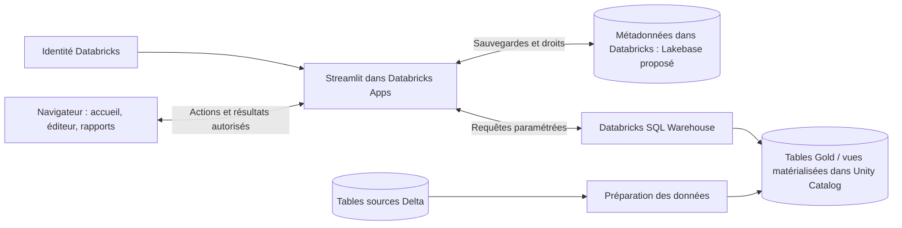

# KPI-Card — sauvegarde, utilisateurs et partage en production

> Proposition pour l'application actuelle, rédigée le 14 octobre 2026.
> Ce document décrit les évolutions à développer : la connexion utilisateur,
> la base de données et le partage ne sont pas encore implémentés.
> Cible confirmée : **Databricks Apps et stockage dans Databricks**.
> La section 9 précise le calcul de centaines de KPI sur des volumes importants.

## 1. Les réponses courtes

| Ta question | Solution proposée |
| --- | --- |
| Comment retrouver les tableaux d'un utilisateur ? | Authentifier l'utilisateur, retrouver son identifiant interne, puis charger ses tableaux et ceux qui lui sont partagés. |
| Faut-il stocker l'email, un ID et du JSON ? | Oui : une table d'utilisateurs, une table de tableaux de bord et une colonne JSON par tableau. L'email sert à reconnaître et rechercher une personne ; un identifiant stable sert aux relations. |
| Comment partager le même tableau ? | Ajouter un droit de lecture ou de modification pour un autre utilisateur sur l'identifiant du tableau existant. |
| Où enregistrer les objectifs ? | Dans le JSON du tableau, à l'intérieur de chaque bloc, avec sa valeur, sa période et ses douze valeurs mensuelles éventuelles. |
| Comment sauvegarder la « tête » du rapport ? | Enregistrer les types de blocs, leurs positions, leurs largeurs, leurs titres, les KPI choisis et leurs paramètres. L'interface reconstruit ensuite le rapport à partir de cette configuration. |

**Architecture recommandée : Streamlit dans Databricks Apps, identité Databricks,
tables analytiques Delta gouvernées dans Unity Catalog et calculs via un SQL Warehouse.
Pour les sauvegardes de rapports et les droits, Lakebase PostgreSQL dans Databricks
est une option adaptée aux écritures interactives, à confirmer selon votre environnement.
Le serveur Python de Streamlit gère les accès ; une API séparée n'est pas nécessaire à ce stade.**

## 2. Ce que fait le projet aujourd'hui

Dans `components/home_editor_frontend/editor.js`, les tableaux sont enregistrés
dans le `localStorage` du navigateur sous la clé `kpi-card:dashboards:v2`.
Le composant transmet aussi la collection à Python ; `components/home_editor.py`
la conserve dans `st.session_state`.

Conséquences pour notre POC :

- Les tableaux ne sont pas rattachés à un compte utilisateur.
- Un autre ordinateur ou navigateur ne récupère pas automatiquement la collection.
- Deux personnes utilisant le même profil de navigateur et la même adresse de
  l'application peuvent retrouver la même collection locale.
- La session Streamlit ne constitue pas la sauvegarde durable des rapports.
- Les données des KPI sont fictives et générées dans `data.js`.

Nous avons déjà le format des blocs et des objectifs. Le travail de production
consiste principalement à ajouter leur stockage central et les droits d'accès.

## 3. L'architecture proposée



La base conserve les sauvegardes de référence. Le navigateur affiche les rapports
et garde les modifications en cours d'édition. Le serveur décide de ce que chaque
utilisateur peut consulter ou modifier avant d'envoyer ou d'enregistrer un tableau.

### Identifier la personne connectée

L'adresse email doit provenir d'une connexion authentifiée. Un champ dans lequel
quelqu'un saisit une adresse email ne suffit pas à identifier cette personne.

Pour une connexion OpenID Connect, on associe l'identité externe au compte interne
avec le couple `iss` + `sub` : fournisseur d'identité et identifiant du compte.
L'email peut changer ; il ne doit donc pas être la clé de propriété des tableaux.
Cette distinction est définie par la [spécification OpenID Connect](https://openid.net/specs/openid-connect-core-1_0.html#ClaimStability).

**La production sera sur Databricks Apps.** Le dépôt contient déjà `app.yaml`
et un dossier `.databricks`. Databricks Apps transmet notamment `X-Forwarded-User` et
`X-Forwarded-Email`. L'adaptateur Python peut utiliser cette identité, avec le
contexte de l'environnement, pour retrouver le compte interne. Ces en-têtes ne
doivent être considérés comme fiables que lorsqu'ils arrivent par le proxy
Databricks authentifié, pas depuis une requête publique quelconque.
[Documentation des en-têtes Databricks Apps](https://docs.databricks.com/aws/en/dev-tools/databricks-apps/http-headers).

L'authentification est apportée par Databricks Apps. Les règles de propriété et de
partage de chaque rapport restent à développer dans KPI-Card.

## 4. Quatre tables pour commencer

| Table | Champs principaux | Rôle |
| --- | --- | --- |
| `users` | `id`, `identity_provider`, `identity_subject`, `email`, `display_name` | Un compte par identité authentifiée. Unicité du couple fournisseur + identité. |
| `dashboards` | `id`, `owner_id`, `name`, `description`, `definition`, `revision`, `created_at`, `updated_at`, `deleted_at` | Une ligne par tableau. `definition` contient le JSON de sa configuration. |
| `dashboard_members` | `dashboard_id`, `user_id`, `role` | Les utilisateurs supplémentaires autorisés, avec le rôle `viewer` ou `editor`. |
| `dashboard_preferences` | `dashboard_id`, `user_id`, `is_favorite` | Les préférences personnelles, notamment les favoris. |

Avec Lakebase PostgreSQL, les identifiants internes des utilisateurs et des tableaux peuvent être des UUID.
Les relations utilisent ces identifiants avec des clés étrangères. Les deux
dernières tables ont une contrainte d'unicité sur `(dashboard_id, user_id)`.
Le propriétaire est désigné par `dashboards.owner_id`.

Je recommande une colonne PostgreSQL **`JSONB`** pour `definition`. PostgreSQL sait
stocker et interroger ce format JSON, avec des possibilités d'indexation.
Le JSON est directement dans la ligne du tableau ; aucun fichier `.json` séparé
n'est nécessaire pour chaque sauvegarde.
[Types JSON de PostgreSQL](https://www.postgresql.org/docs/current/datatype-json.html).

Un favori doit rester personnel : si Alice ajoute un tableau partagé à ses favoris,
cela ne modifie pas les favoris de Bob. La période choisie temporairement pour
consulter un rapport peut aussi rester personnelle ; sa période par défaut est
enregistrée avec le rapport.

**Lakebase**, lorsqu'il est disponible dans votre environnement Databricks,
peut fournir cette base PostgreSQL et conserver les données entre les déploiements.
[Ressource Lakebase pour Databricks Apps](https://docs.databricks.com/aws/en/dev-tools/databricks-apps/lakebase).

Si « base Databricks » signifie exclusivement des tables Delta dans Unity Catalog,
le modèle logique reste applicable, avec par exemple le JSON dans une colonne
`STRING`. `JSONB` est un type PostgreSQL : les types, contraintes et opérations de
sauvegarde présentés ici devront être adaptés à Delta. Le choix Lakebase/Delta pour
les métadonnées est distinct du stockage analytique des millions de lignes.

## 5. Sauvegarder la présentation et les objectifs

Exemple de contenu proposé pour `dashboards.definition`, reprenant les champs
actuels des blocs. `schemaVersion` est ajouté pour pouvoir faire évoluer le format
des sauvegardes ; le nom et le propriétaire sont dans les colonnes de la table.

```json
{
  "schemaVersion": 1,
  "category": "Commercial",
  "theme": "blue",
  "period": "rolling12",
  "layout": {
    "version": 1,
    "blocks": [
      {
        "id": "bloc-ca",
        "type": "card",
        "row": 0,
        "col": 0,
        "span": 2,
        "content": "Chiffre d’affaires HT",
        "kpiId": "revenue",
        "period": "inherit",
        "target": {
          "mode": "simple",
          "value": 1000,
          "period": "month",
          "direction": "at_least",
          "monthlyValues": [null, null, null, null, null, null, null, null, null, null, null, null]
        }
      }
    ]
  }
}
```

Ce JSON signifie : une carte en première ligne, occupant deux colonnes sur six,
affichant le CA et suivant la période du tableau. Son objectif est de 1 000 par mois,
avec un minimum à atteindre. Les indices `row` et `col` commencent à zéro.
Pour un graphique, on conserve aussi `chartKind`, par exemple `bar` ou `line`.

En mode avancé, le même bloc peut contenir :

```json
{
  "mode": "monthly",
  "value": 1000,
  "period": "month",
  "direction": "at_least",
  "monthlyValues": [1000, 1000, 1200, 1400, 1500, 1500, 800, 800, 1400, 1600, 1700, 2000]
}
```

Les douze valeurs correspondent à janvier–décembre. Le mode actif utilise ces
valeurs ; `value` et `period` conservent la saisie du mode simple pour pouvoir y
revenir. Dans le fonctionnement actuel, cette grille mensuelle est reconduite
chaque année. Si l'on veut plus tard des objectifs différents pour 2027 et 2028,
il faudra ajouter une année ou une période de validité à ce modèle.

**Enregistrer le tableau sauvegarde ses blocs et leurs objectifs dans la même
opération.** Il n'est pas nécessaire d'avoir une table d'objectifs supplémentaire
pour le périmètre actuel.

On sauvegarde les cibles saisies. L'objectif adapté au rapport, l'écart au réalisé
et la ligne d'objectif sont recalculés selon les dates affichées. Pour les KPI
additifs, 1 000 par mois donne 12 000 sur une année complète ; les mois partiels
utilisent le prorata défini dans `targets.js`. Les taux et moyennes conservent leur
règle de seuil. Les valeurs KPI réalisées proviennent des données sources.

Le fond, le header, les styles et le code des composants restent dans l'application
déployée. La configuration JSON suffit à reconstruire la composition du rapport.

## 6. Charger, enregistrer et partager

### Au démarrage

1. Le serveur récupère l'identité authentifiée et son `users.id`.
2. Il charge les tableaux dont cet utilisateur est propriétaire ou membre autorisé.
3. Il ajoute ses favoris et son rôle sur chaque tableau.
4. Il transmet uniquement cette collection autorisée au composant d'accueil.

Le filtre métier est donc : **« mes tableaux + les tableaux qui me sont partagés »**.
Il s'applique sur le serveur avant d'envoyer les données au navigateur, et lors de
l'ouverture d'un tableau par son identifiant.

### Au clic sur Enregistrer

1. Le navigateur transmet le tableau modifié, son ID et la révision qu'il a ouverte.
2. Le serveur vérifie l'identité, le droit de modification et le contenu : types
   de blocs, grille de six colonnes, KPI autorisés, périodes et objectifs valides.
3. Il met à jour uniquement ce tableau, dans une transaction, si la révision reçue
   correspond toujours à celle en base. Il incrémente alors `revision`.
4. L'interface affiche « Enregistré » après confirmation du serveur.

Si Alice et Bob modifient la même révision, la première sauvegarde réussit ; la
seconde doit signaler le conflit et proposer de recharger ou de conserver une copie
du brouillon. Cela évite d'écraser silencieusement le travail de l'autre.

La création attribue le propriétaire depuis l'identité côté serveur. Les actions
de suppression, restauration, partage et modification revérifient également les
droits. `deleted_at` permet une suppression réversible si l'on souhaite conserver
le fonctionnement actuel du bouton d'annulation.

### Partager avec un autre utilisateur

Exemple : Alice possède un tableau et veut le partager avec Bob.

1. Alice choisit **Partager**, recherche Bob par son email et sélectionne son compte.
2. Elle choisit **Lecture** ou **Modification**.
3. Le serveur ajoute une ligne dans `dashboard_members`, après avoir vérifié
   qu'Alice est propriétaire.
4. Bob retrouve le tableau dans son accueil ou l'ouvre via son lien après connexion.

| Rôle | Consulter | Modifier les blocs et objectifs | Gérer les partages / supprimer |
| --- | --- | --- | --- |
| Propriétaire | Oui | Oui | Oui |
| Éditeur | Oui | Oui | Non |
| Lecteur | Oui | Non | Non |

Alice et Bob consultent **le même identifiant et la même sauvegarde en base**.
Les changements enregistrés seront visibles à la prochaine ouverture ou
actualisation. L'édition simultanée en temps réel serait une fonctionnalité distincte.
Une copie personnelle aurait un nouvel identifiant et ses propres objectifs.

Pour une première version, le partage peut cibler les utilisateurs déjà connus de
l'application. Les invitations aux personnes encore inconnues pourront être ajoutées
ensuite. Retirer un membre retire son accès aux prochaines requêtes ; un simple
lien vers le tableau ne constitue jamais une autorisation.

## 7. Les adaptations concrètes dans notre projet

| Emplacement | Évolution à développer |
| --- | --- |
| `app.py` | Identifier l'utilisateur avant de servir les pages. |
| Nouveau module d'authentification | Traduire l'identité Databricks ou OIDC en compte interne. |
| Nouveau module de stockage Python | Charger les tableaux autorisés et gérer sauvegardes, révisions, droits et favoris en base. |
| `components/home_editor.py` | Charger la collection depuis la base et traiter les actions du composant. |
| `components/home_editor_frontend/editor.js` | Utiliser la collection serveur, envoyer des actions par tableau et afficher les confirmations ou erreurs. Ajouter le partage et l'affichage des rôles. |
| `layout.js`, `targets.js` et validation Python | Conserver le format des blocs ; ajouter une validation serveur équivalente aux règles de l'éditeur. |
| Configuration de déploiement | Déclarer la connexion à la base et les paramètres d'authentification côté serveur. |

Deux points spécifiques à notre composant demandent une adaptation :

- Aujourd'hui, la collection locale est prioritaire sur `args.initial` et
  `initialize()` ne s'applique qu'une fois. En production, le composant doit
  prendre en compte les réponses serveur et les changements de compte ou de révision.
- Aujourd'hui, le navigateur renvoie toute la collection. En production, on envoie
  des actions explicites sur un tableau (`save`, `delete`, `share`, `favorite`),
  avec un identifiant de requête pour éviter de les rejouer lors des réexécutions
  Streamlit. On ne remplace pas tous les tableaux en base par la collection reçue.

Le `localStorage` peut éventuellement garder un brouillon, isolé par compte et
tableau. Il ne doit plus décider quels rapports sont accessibles. À la déconnexion,
le composant et l'état utilisateur doivent être réinitialisés ; les caches serveur
éventuels doivent tenir compte de l'utilisateur et de ses droits.

## 8. Passage du POC à cette première production

1. Configurer Databricks Apps et son identité, puis confirmer Lakebase ou Delta
   pour les métadonnées des rapports.
2. Créer les quatre tables et leur connexion serveur, avec sauvegardes de la base
   et secrets conservés dans la configuration de l'hébergement.
3. Brancher le chargement et les actions de sauvegarde sur le composant existant.
4. Ajouter les droits de partage et les favoris personnels.
5. Prévoir un import ponctuel des tableaux locaux : depuis le navigateur qui les
   possède, les transmettre au serveur après connexion. Le serveur les valide,
   attribue de nouveaux IDs de tableaux et les rattache au compte connecté.

Les sauvegardes locales restent dans les navigateurs où elles ont été créées ;
elles ne peuvent pas être récupérées centralement sans cet import. Chaque utilisateur
doit pouvoir choisir ce qu'il importe, notamment sur un navigateur utilisé à plusieurs.

Cette architecture suffit à centraliser les rapports, leur composition et leurs
objectifs. Les données métier réelles pourront être raccordées ensuite. Lors de ce
raccordement, les droits sur les données sources et les exports CSV devront être
appliqués côté serveur : partager un rapport ne doit pas accorder automatiquement
un accès à toutes les données de l'entreprise.

**À retenir : l'identité désigne la personne, les droits désignent ses tableaux
accessibles, et le JSON de chaque tableau décrit ses blocs et leurs objectifs.**

## 9. Des centaines de KPI sur des millions de lignes : où calculer ?

### Recommandation : préparation dans Databricks + SQL à la consultation

**Centraliser les définitions des KPI, préparer les opérations coûteuses, puis
calculer la période choisie dans le SQL Warehouse sur des données adaptées.**
L'application transmet les paramètres et affiche les résultats. Elle ne charge
pas les millions de lignes dans Python ou dans le navigateur pour les agréger.
Un SQL Warehouse peut être déclaré comme ressource de Databricks Apps.
[Connexion d'une App à un SQL Warehouse](https://docs.databricks.com/aws/en/dev-tools/databricks-apps/sql-warehouse).

Je ne recommande pas de commencer par stocker une valeur pour chaque combinaison
`KPI × période × filtre × utilisateur`. Les combinaisons se multiplient et les
périodes glissantes doivent être recalculées à chaque nouvelle date de référence.
On matérialisera certaines combinaisons très utilisées si les mesures de performance
en montrent l'intérêt.

### Trois éléments complémentaires

| Élément | Contenu | Utilité |
| --- | --- | --- |
| Catalogue métier des KPI | Identifiant stable, définition, source, formule, unité, date métier, dimensions autorisées, fraîcheur attendue, règle d'agrégation | Une définition commune, utilisée par la page Catalogue KPI et par les rapports. |
| Tables Gold ou vues matérialisées | Données nettoyées, jointures préparées et agrégats réutilisables, souvent au jour | Éviter de refaire les traitements lourds à chaque ouverture. |
| Requêtes SQL de consultation | KPI demandés, dates exactes, filtres et granularité du graphique | Produire le total et les points du graphique pour la sélection de l'utilisateur. |

Dans Unity Catalog, les **Metric Views** peuvent centraliser les mesures et les
dimensions et permettre leur interrogation à différentes granularités. Elles
constituent une couche de définition métier ; leur seule création ne garantit pas
que tous les résultats sont précalculés. Leur disponibilité et leurs possibilités
de matérialisation seront à vérifier sur votre environnement.
[Interroger les Metric Views](https://docs.databricks.com/aws/en/uc-semantics/metric-views/query).

La page « Catalogue KPI » de notre application pourra présenter ces définitions.
Il faudra éviter de maintenir deux formules indépendantes, une dans le catalogue
JavaScript et une autre en SQL : la définition de production doit avoir une source
de référence versionnée.

### Exemple : une préparation quotidienne réutilisable

Pour les ventes, une table Gold pourrait avoir ce grain :

`date_metier × organisation × agence × produit`

Et contenir : `montant_ht`, `cout_ht`, `nombre_ventes`.
La préparation doit garantir qu'une jointure ne duplique pas les ventes.
Les dimensions conservées dépendent des filtres et des droits nécessaires ; il
faut éviter de créer toutes les combinaisons imaginables. Une forte cardinalité
peut limiter fortement la réduction de volume.

À partir de cette table, la même requête sert plusieurs périodes et plusieurs KPI :

```sql
-- Exemple de modèle SQL ; noms de tables et périmètre à adapter.
-- Paramètres liés par le connecteur, et périmètre validé côté serveur.
SELECT
    SUM(montant_ht) AS chiffre_affaires,
    SUM(nombre_ventes) AS ventes,
    SUM(montant_ht) / NULLIF(SUM(nombre_ventes), 0) AS panier_moyen,
    100.0 * (SUM(montant_ht) - SUM(cout_ht))
        / NULLIF(SUM(montant_ht), 0) AS taux_marge
FROM production.gold.ventes_journalieres
WHERE date_metier >= :date_debut
  AND date_metier < :date_fin_exclusive
  AND organisation_id = :organisation_autorisee;
```

L'application traduit « année en cours », « 6 mois glissants » ou « semaine » en
bornes de dates. Le SQL filtre les jours correspondants. Pour une courbe mensuelle,
il regroupe ensuite les jours par mois ; les mois partiels restent correctement
filtrés. Une table uniquement mensuelle ne permettrait pas de répondre exactement
à une semaine ou à un mois incomplet.

La date métier et le fuseau sont définis par KPI. Un grain quotidien convient aux
rapports au jour ; un besoin à l'heure nécessiterait un grain plus fin. Une année
civile complète, l'année en cours et douze mois glissants sont trois sélections
différentes, dont les bornes doivent être explicites.

### Tous les indicateurs ne peuvent pas être additionnés

| Type de KPI | Ce qu'il faut conserver / calculer |
| --- | --- |
| CA, quantité, nombre d'événements | Sommes et comptages quotidiens, additionnables sur la période si le grain est correct. |
| Panier moyen, délai moyen | Somme des montants ou délais et nombre d'observations ; calculer le ratio des sommes. |
| Taux de marge, taux de satisfaction | Numérateur et dénominateur ; recalculer le taux global, sans moyenner les pourcentages quotidiens. |
| Clients ou projets distincts | Calcul distinct sur la période demandée, ou structure fusionnable adaptée. Additionner les distincts journaliers compterait plusieurs fois les mêmes entités. Toute approximation doit être acceptée explicitement. |
| Stock, encours, solde | État à une date ou moyenne d'états, selon la définition métier ; les soldes journaliers ne se somment pas comme des ventes. |
| Médiane, percentile | Calcul sur les observations ou structure adaptée ; les médianes quotidiennes ne suffisent pas à calculer la médiane globale. |

Les KPI complexes peuvent donc continuer à interroger des faits détaillés optimisés,
ou bénéficier d'une préparation spécifique. Il n'est pas nécessaire d'imposer le
même stockage à tous les indicateurs.

### Préparation, fraîcheur et cache

Les traitements lourds peuvent être exécutés par des jobs/pipelines ou des vues
matérialisées. Databricks peut rafraîchir certaines vues de manière incrémentale,
mais cela dépend des requêtes et du plan retenu ; un recalcul complet reste possible.
[Rafraîchissement des vues matérialisées](https://docs.databricks.com/gcp/en/ldp/incremental-refresh).

La fréquence suit le besoin métier : quotidienne, horaire ou plus fréquente.
Les corrections et suppressions historiques doivent également être répercutées,
pas uniquement les nouvelles lignes. Le rapport doit afficher la fraîcheur réelle
des données ; les graphiques et les données brutes doivent utiliser une version
cohérente pour que leurs chiffres puissent être rapprochés.

Databricks SQL dispose de caches de résultats. Ils peuvent accélérer les requêtes
répétées, sans remplacer une modélisation adaptée. Notre application Streamlit
personnalisée ne bénéficie pas automatiquement de toutes les fonctions de cache
des dashboards natifs Databricks.
[Cache des requêtes SQL](https://docs.databricks.com/gcp/en/sql/user/queries/query-caching).

### Ce que doit faire KPI-Card à l'ouverture d'un rapport

1. Charger les blocs autorisés et identifier uniquement les KPI utilisés dans ce rapport.
2. Résoudre les dates, les filtres et le périmètre d'accès côté serveur.
3. Regrouper les KPI compatibles dans une même requête : plusieurs mesures sur les
   mêmes faits et les mêmes filtres peuvent être calculées ensemble.
4. Interroger le SQL Warehouse et renvoyer uniquement les totaux et séries utiles.
5. Comparer ces résultats aux objectifs sauvegardés dans les blocs.
6. Charger les lignes détaillées au clic, avec pagination côté serveur. Un export
   volumineux peut nécessiter une génération différée et un téléchargement dédié.

Un catalogue de 500 KPI n'implique donc pas 500 calculs à chaque ouverture. Un rapport
de 12 blocs demande ses 12 indicateurs, parfois avec moins de 12 requêtes. Les changements
de titre ou de largeur ne doivent pas relancer les calculs des données.

Les requêtes utilisent des paramètres liés et un registre de KPI autorisés. Le JSON
d'un bloc contient un `kpiId`, pas du SQL arbitraire à exécuter. Les caches applicatifs
doivent intégrer les dates, filtres, versions des définitions et périmètres de droits.

Pour les données, configurer explicitement l'autorisation utilisateur Databricks
si les requêtes doivent respecter ses permissions Unity Catalog. Une requête exécutée
avec l'identité de service de l'application suit les droits de cette identité :
l'email affiché ne suffit pas à appliquer les droits de l'utilisateur.
[Autorisation des Databricks Apps](https://docs.databricks.com/aws/en/dev-tools/databricks-apps/auth).

### Choix initial conseillé pour ce projet

- **Données métier :** tables Delta et préparations Gold par domaine dans Unity Catalog.
- **Calcul :** SQL Warehouse, formules centralisées, agrégats quotidiens lorsque le KPI s'y prête.
- **Rapports, objectifs, partages :** stockage de configuration distinct des données analytiques ; Lakebase proposé, ou adaptateur Delta si c'est la contrainte retenue.
- **Optimisation ciblée :** matérialiser davantage seulement les calculs coûteux et fréquents.

Avant de dimensionner le warehouse, mesurer un ensemble représentatif de rapports :
jointures, volume réellement lu, utilisateurs simultanés, temps à froid et à chaud,
temps de réponse au 95e percentile et coût. Le seul nombre de lignes ne permet pas
de promettre un temps de réponse. Aucun benchmark de votre environnement n'a été réalisé.

**En bref : un catalogue commun de définitions, des préparations réutilisables dans
Databricks et du SQL paramétré à la consultation. Les variantes temporelles sont
principalement des filtres de dates, avec des règles d'agrégation propres à chaque KPI.**
